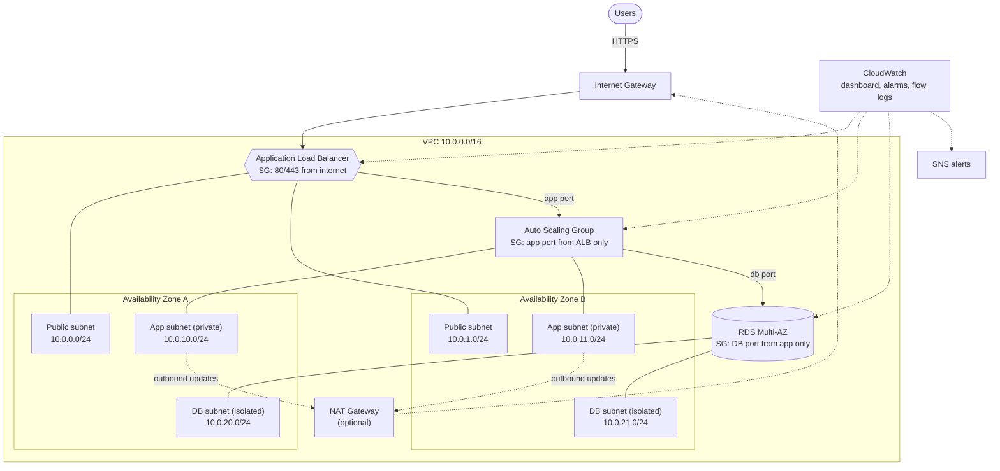

# AWS Three-Tier Architecture with Terraform

[](https://github.com/inmartac90/aws-three-tier-terraform/actions/workflows/terraform-ci.yml)


A production-style, highly available **three-tier architecture on AWS**, written as modular Terraform: a public web tier behind an Application Load Balancer, a private application tier on Auto Scaling, and an isolated Multi-AZ database tier, with **CloudWatch observability** and **least-privilege IAM**.

The project is built in phases. Each phase is self-contained, validated in CI and documented here.

## Target architecture

Phases 2–4 add the ALB, Auto Scaling Group, RDS and CloudWatch pieces shown below (see Roadmap).



## Design decisions

| Decision | Why |
|---|---|
| **Three subnet tiers per AZ** (public, app, db) | Each tier is isolated by routing *and* security groups. |
| **DB subnets have no internet route** | The data tier can't reach or be reached from the internet, even if a security group is misconfigured. |
| **Security groups reference each other**, not CIDRs | ALB → app → DB. Scaling or replacing instances never requires rule changes. |
| **No egress rules on the DB tier** | The database never initiates connections. |
| **Default security group locked down** | Nothing can accidentally use the permissive default SG. |
| **One app route table per AZ** | Lets each AZ use its own NAT Gateway for full AZ independence when needed. |
| **NAT Gateway and Flow Logs behind toggles** | Free-tier-friendly by default; turn on for demos or production. |
| **Flow Logs IAM role scoped to one log group** | Least privilege: it can only write to its own log group. |
| **Input validation on variables** | Bad CIDRs, environments or AZ counts fail at `plan`, not at deploy. |

## Roadmap

| Phase | Scope | Status |
|---|---|---|
| 1 | **Network**: VPC, public/app/db subnets across AZs, IGW, optional NAT, route tables, VPC Flow Logs | ✅ Done |
| 1 | **Security**: tiered security groups (ALB → app → DB) | ✅ Done |
| 1 | **CI**: `terraform fmt`, `validate`, tflint, Checkov on every PR | ✅ Done |
| 2 | **Compute**: ALB with HTTPS listener, Launch Template, Auto Scaling Group, IMDSv2 | 🔜 Next |
| 3 | **Data**: RDS Multi-AZ, credentials in Secrets Manager, encryption at rest | ⏳ Planned |
| 4 | **Observability**: CloudWatch dashboard, alarms (ALB 5xx, CPU, RDS connections), SNS | ⏳ Planned |
| 5 | **Hardening**: remote state (S3 + locking), VPC endpoints, cost estimate | ⏳ Planned |

## Project structure

```
.
├── main.tf                  # Wires the modules together
├── variables.tf             # Inputs with validation
├── outputs.tf
├── providers.tf             # AWS provider with default tags
├── versions.tf              # Terraform/provider versions, backend
├── terraform.tfvars.example
├── modules/
│   ├── network/             # VPC, subnets, routing, NAT, flow logs
│   └── security/            # Tiered security groups
└── .github/workflows/
    └── terraform-ci.yml     # fmt, validate, tflint, checkov
```

## Usage

```bash
cp terraform.tfvars.example terraform.tfvars
terraform init
terraform plan
terraform apply      # Phase 1 defaults deploy free-tier-friendly resources only
terraform destroy    # clean up
```

### Key inputs

| Name | Description | Default |
|---|---|---|
| `aws_region` | Region to deploy into | `us-east-1` |
| `project_name` | Name prefix for resources | `three-tier` |
| `environment` | `dev`, `staging` or `prod` | `dev` |
| `vpc_cidr` | VPC CIDR block | `10.0.0.0/16` |
| `az_count` | Number of AZs (2 or 3) | `2` |
| `enable_nat_gateway` | Create NAT Gateway(s) | `false` |
| `single_nat_gateway` | One shared NAT instead of one per AZ | `true` |
| `enable_flow_logs` | VPC Flow Logs to CloudWatch | `false` |
| `app_port` / `db_port` | Tier ports | `8080` / `5432` |

## Cost notes

With the defaults, Phase 1 creates only resources that have **no hourly charge** (VPC, subnets, route tables, internet gateway, security groups).

| Optional resource | Approx. cost (us-east-1) |
|---|---|
| NAT Gateway | ~$0.045/hour + data processing |
| VPC Flow Logs | CloudWatch Logs ingestion and storage |
| ALB, EC2, RDS (later phases) | Billed per hour; deploy briefly for demos, then `destroy` |

## Security scanning

Checkov runs on every pull request. Expected, reviewed findings:

- **ALB security group allows 0.0.0.0/0 on 80/443.** Intentional: it is the public entry point. Port 80 only redirects to HTTPS once the listener is added in Phase 2.
- **Flow logs disabled by default.** Intentional for cost; enable with `enable_flow_logs = true`.

## Author

**Indra Martínez** · Cloud & Observability Engineer · [inmartac.dev](https://inmartac.dev) · [LinkedIn](https://www.linkedin.com/in/inmartac)
